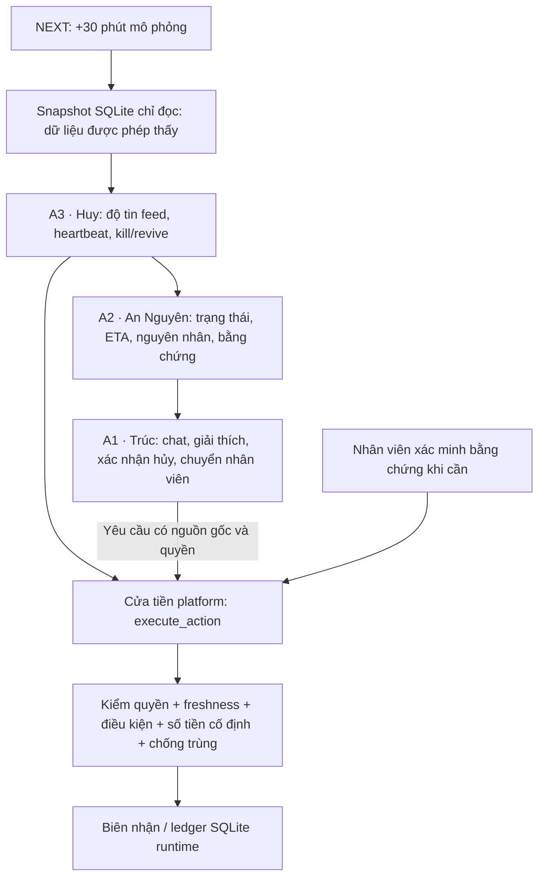

# SEA OpenAI — Chăm sóc đơn giao trễ có kiểm soát

**Ascendant · An Nguyên, Huy, Trúc · Hackathon 31/10/2026**<br>
Hướng đăng ký: **Autonomous & Adaptive AI**.

Khi đơn có nguy cơ trễ ngày cam kết, khách cần biết đơn đang ở đâu, vì sao chậm và được hỗ trợ thế nào; người bán và vận hành cần bằng chứng để phân biệt lỗi vận chuyển, lỗi khách và dữ liệu đến muộn. Nhóm xây hệ thống ba agent để kiểm tra nguồn dữ liệu, đánh giá logistics rồi chăm sóc khách, đồng thời chặn chủ động liên hệ và cấp quyền lợi khi thiếu điều kiện. Đây là bản demo trên dữ liệu tổng hợp; quyền lợi chỉ ghi vào SQLite nội bộ.

**Demo:** [sea-openai-ops-559aa5.azurewebsites.net](https://sea-openai-ops-559aa5.azurewebsites.net/)<br>
**Bài nộp:** [Write-up](docs/write-up.md) · [PDF](docs/write-up.pdf) · [Declarations](docs/declarations.md) · [PDF](docs/declarations.pdf) · [Nhật ký Codex](docs/codex-log.md).

## Kiến trúc và cửa tiền



A2, A3 và LLM không tự ghi tiền. LLM chỉ chọn `phrase_id` trong danh mục cho phép; code điền dữ kiện, ngày và số tiền. Demo chat đã có luồng xu nội bộ, xác nhận yêu cầu hủy để chờ duyệt và chuyển nhân viên. Hủy chưa phải hủy đơn trên sàn; không có kết nối ví Shopee hay nhà cung cấp tài chính. Voucher có bộ thực thi riêng nhưng chưa được xác nhận chạy xuyên suốt qua A1. Voice đang làm, chưa tính là tính năng hoàn tất ở mốc tài liệu này.

## Chạy local — 3 lệnh

Cần Python 3.11+ độc lập, chạy tại gốc repo. Cung cấp riêng hai tệp `core_14d.sqlite`, `ops_14d.sqlite` trong `data/release_main/`; chúng bị Git ignore. Runtime dùng đường dẫn riêng ngoài dữ liệu nguồn. Bản web tích hợp Python phục vụ ngay dashboard, không cần build Next.js để thử luồng này.

```powershell
python -m venv .venv
.\.venv\Scripts\python.exe -m pip install -r requirements.txt
.\.venv\Scripts\python.exe -m platform_huy.serve_ui --integrated --port 8765 --state-path runs/submission-demo/state.sqlite
```

Mở [http://127.0.0.1:8765/](http://127.0.0.1:8765/). Trên macOS/Linux, thay đường dẫn Python bằng `.venv/bin/python`. Muốn dùng OpenAI thật, đặt `OPENAI_API_KEY` và tùy chọn `OPENAI_MODEL` trong môi trường hoặc `.env` riêng, rồi thêm `--llm` vào lệnh cuối; mặc định code tại mốc đối chiếu là `gpt-5.4-mini`. Không đưa khóa vào Git. Không bật LLM vẫn chạy được bằng template. Xem [kịch bản demo](platform_huy/DEMO.md) và [frontend Next.js riêng](frontend/README.md).

## Phần làm trong hackathon 31/10

Mốc đầu ngày của repo thi là commit [`25131a2`](https://github.com/annguyenphanhuu/sea-openai/commit/25131a261e74a8e4aa730abe117f0ccd127efabf), **09:09:30 +07:00**, chỉ có `README.md` một dòng. Scaffold đầu tiên là `919fef3` lúc **09:53:09**. Bảng dưới đối chiếu lịch sử đến [`b00d78e`](https://github.com/annguyenphanhuu/sea-openai/commit/b00d78e93aa972c3bce0888d5e955b71479eb2a7), **14:47:50**, ngày 31/10/2026; không bao gồm thay đổi đang làm sau đó.

| Thư mục | Phần xây trong ngày | Commit tiêu biểu |
| --- | --- | --- |
| `contracts/`, `requirements/` | Kiểu dữ liệu, tham số, schema và phụ thuộc | `919fef3`, `42fd165` |
| `platform_huy/` | SQLite runtime, A3, NEXT, cửa thực thi, nối A1, dashboard | `6431a3b`, `8f0b554`, `6dd2652`, `3c70fe2`, `3a025b7` |
| `logistics_an_nguyen/` | Replay theo thời điểm, đánh giá A2, ETA, bằng chứng, danh sách đơn | `ba7d465`, `25fd56c`, `7b4fc36` |
| `care_truc/` | Luật hội thoại A1, xác nhận hủy, handoff, lưu phiên, chọn câu bằng OpenAI | `a3c29c3`, `ada9abb`, `87b6934` |
| `frontend/` | Giao diện Next.js và kết nối runtime local | `f1a1874` |
| `deploy/` | Đóng gói, kiểm tra release và khởi động triển khai | `9309df5`, `2b6edcb` |
| `acceptance_huy/`, `acceptance_an_nguyen/`, `acceptance_truc/`, `care_truc/tests/` | Kiểm thử giới hạn quyền, replay, hội thoại và tích hợp | Lịch sử theo từng thư mục |
| `docs/`, `.scratch/`, `scripts/`, cấu hình gốc | Tài liệu, kế hoạch/review, bằng chứng chạy và công cụ hỗ trợ | `ee8fa36`, `d3d402f` và lịch sử thư mục |

Lịch sử Git cho thấy phần được thêm vào repo trong ngày; tuyên bố không chép mã nguồn cũ là khai báo của nhóm, không phải kết luận kiểm định độc lập chỉ từ ngày commit. Dữ liệu được chuẩn bị trước và khai riêng trong [Declarations](docs/declarations.md).

## Repo tập dượt cũ

[vinhhuy12/sea-openai-hackathon](https://github.com/vinhhuy12/sea-openai-hackathon) là repo chuẩn bị và diễn tập trước sự kiện, có thể cần quyền truy cập. Nhóm **chỉ dùng ý tưởng, nghiên cứu, kế hoạch và bài học thiết kế; không chép code giải pháp** sang repo thi. Bộ dữ liệu tổng hợp chuẩn bị trước được dùng làm đầu vào và được khai báo riêng. Các số đo bản tập dượt không phải kết quả bài thi này.

## Công cụ

Theo khai báo của nhóm, **Codex viết code, viết/chạy test và thực hiện deploy** theo nhiệm vụ được giao; dùng subagent có phạm vi, worktree riêng cho phần triển khai độc lập và lượt review với context sạch. Người phụ trách chốt luật nghiệp vụ, đọc kết quả và quyết định tích hợp. **Claude chỉ đọc, review và viết prompt, không chạm code giải pháp trong ngày thi**. Riêng dữ liệu chuẩn bị trước có câu ticket gốc do Claude tạo, đã khai trong Declarations.

## Bằng chứng và giới hạn

Ba số liệu giới thiệu nằm ở [pitch-notes.md](docs/pitch-notes.md): đều là thống kê hồi cứu trên dữ liệu tổng hợp, không phải hiệu quả kinh doanh hay dữ kiện tương lai được cấp cho agent. [Write-up](docs/write-up.md) ghi phạm vi và bốn cảnh demo. [Codex log](docs/codex-log.md) phân biệt test từng mốc với trạng thái sau merge; không tuyên bố toàn bộ test hiện tại đều xanh.

Public demo là phòng trình diễn có khóa người trình bày, chưa phải phân quyền khách hàng/nhà bán hàng cho production. Runtime có thể về baseline khi ứng dụng khởi động lại. Xem [quy tắc đóng góp](AGENTS.md), [kiểm định dữ liệu](docs/data_audit.md) và [quyết định nghiệp vụ](docs/decisions.md).
